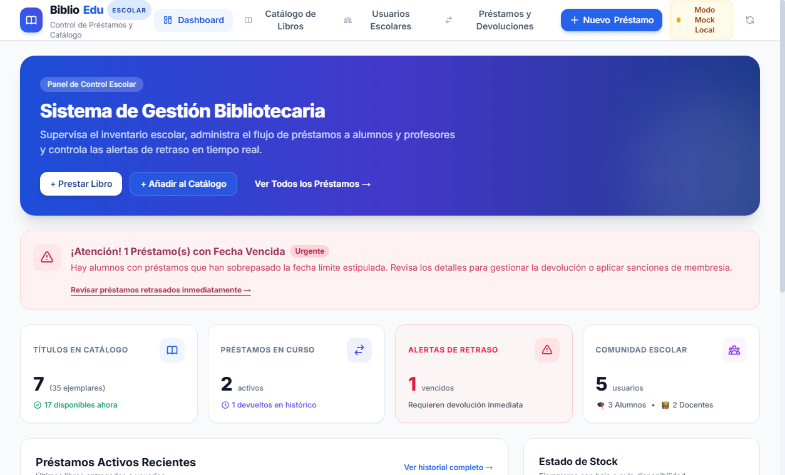
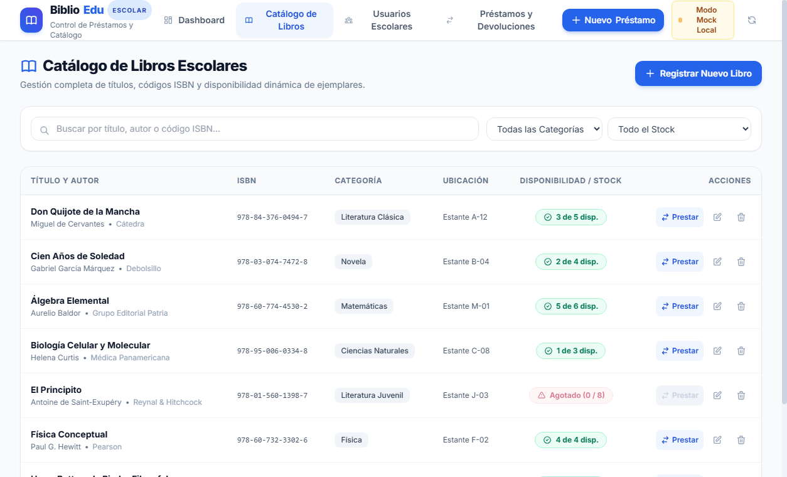
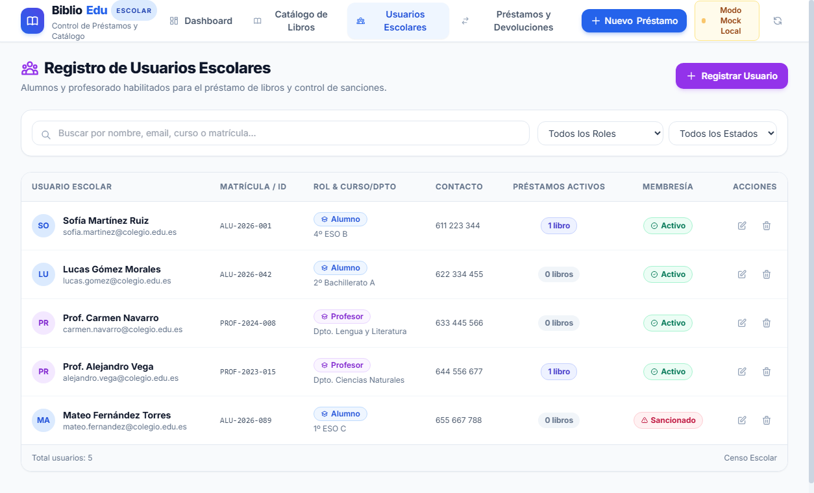
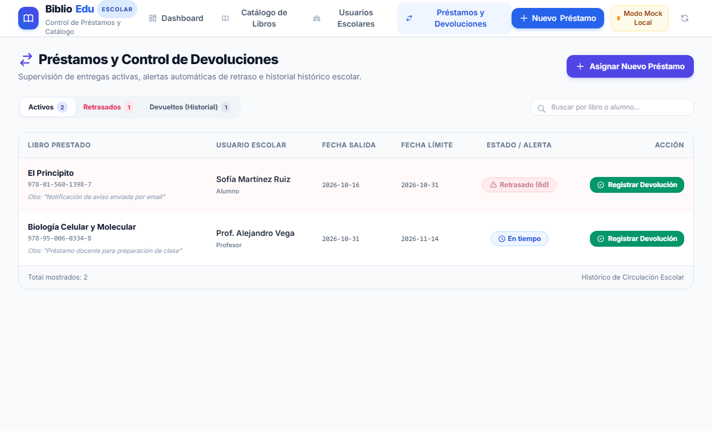
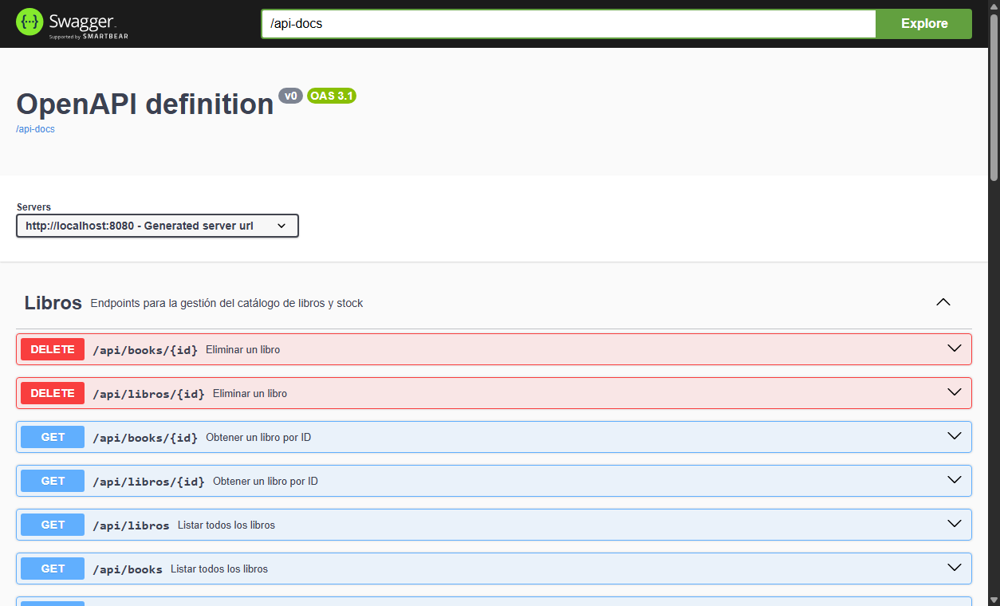

# 📚 Sistema de Gestión de Biblioteca Escolar
### AI-Powered Full-Stack Hackathon (Reto 120 Minutos)

Proyecto desarrollado para el **AI-Powered Full-Stack Hackathon**, enfocado en la construcción, integración y despliegue ágil de una solución integral para la gestión de bibliotecas escolares asistido por herramientas avanzadas de Inteligencia Artificial.



---

## 👥 Estructura del Equipo y División del Trabajo

Para cumplir con los exigentes plazos del reto (120 minutos), el equipo organizó sus responsabilidades en dos áreas principales:

* **Backend, Base de Datos y DevOps (3 miembros):**
  * Diseño de la arquitectura de datos relacional y lógica de negocio con **Spring Boot (Java 21)** y **Spring Data JPA**.
  * Implementación de endpoints REST duales (`/api/books` y `/api/libros`, `/api/users` y `/api/usuarios`, `/api/loans` y `/api/prestamos`).
  * Gestión de stock dinámico con transaccionalidad estricta (descuento automático y reposición al devolver).
  * Logging robusto en español con SLF4J y configuración optimizada para producción (`show-sql=false`).
  * Contenedorización multi-stage con Docker, publicación en Docker Hub y orquestación con Docker Compose.
* **Frontend y Experiencia de Usuario - UI/UX (1 miembro):**
  * Diseño e implementación de la interfaz de usuario con **React** y **Tailwind CSS**.
  * Construcción de un Dashboard interactivo con catálogo de libros, censo de usuarios y gestión activa de préstamos.
  * Modales para altas/ediciones, cálculo visual de retrasos de entrega y filtros reactivos.
  * Empaquetado estático optimizado integrado dentro del backend para eliminar problemas de CORS y permitir un despliegue monolítico ultra-rápido.

---

## 🎯 Alcance Funcional y Reglas de Negocio

Cumpliendo con los tres pilares del enunciado oficial:

### 1. 📖 Gestión de Libros & Stock (CRUD Libros & ISBN)
* Altas, bajas, consultas y modificaciones de ejemplares.
* Validación de formato ISBN.
* Control dinámico de inventario: distinción entre `totalCopias` y `copiasDisponibles`.
* Categorización escolar (Literatura Clásica, Fantasía, Ciencia Ficción, Historia, Matemáticas, etc.) y localización física por estanterías.



### 2. 👨‍🎓 Gestión de Usuarios Escolares (CRUD Usuarios)
* Censo unificado de la comunidad educativa: **Alumnos** y **Profesores**.
* Registro de matrícula escolar (`matricula`), curso/departamento y datos de contacto.
* Control de estados de membresía: `Activo`, `Inactivo` y `Sancionado`.
* Validación contra duplicación de correos electrónicos y matrículas.



### 3. 🔄 Flujo de Préstamo & Devolución Activa
* **Asignación transaccional:** Cada nuevo préstamo decrementa automáticamente en 1 las copias disponibles del libro.
* **Restricción de stock:** No se permite prestar un libro si `copiasDisponibles == 0`.
* **Políticas de devolución escolar:**
  * Alumnos: plazo de devolución de **14 días**.
  * Profesores: plazo de devolución ampliado de **30 días**.
* **Detección automática de demoras:** Alertas de estado *A Tiempo* vs *Retrasado* en base a la fecha límite.
* **Devolución inmediata:** La acción de retorno (`PUT /api/loans/{id}/return`) actualiza el estado a `Devuelto`, registra la fecha efectiva de devolución y repone inmediatamente el stock en el catálogo.



---

## 🛠️ Stack Tecnológico

| Capa | Tecnologías |
| :--- | :--- |
| **Backend** | Java 21, Spring Boot 3.4 / 4.x, Spring Web, Spring Data JPA, Hibernate, Lombok |
| **Frontend** | React, Tailwind CSS, Lucide Icons, Vite (empaquetado estático en `/resources/static`) |
| **Base de Datos** | PostgreSQL 16 (con volumen persistente `postgres_data`) |
| **API Docs** | OpenAPI 3 / Swagger UI (`/swagger-ui.html`) |
| **Logging** | SLF4J / Logback con mensajes estructurados en español |
| **DevOps** | Docker (multi-stage build), Docker Compose, Docker Hub (`xvirr/biblioteca-app`) |

---

## 🚀 Despliegue y Ejecución Rápida

La aplicación está preparada para ejecutarse en cualquier entorno en cuestión de segundos.

### Opción 1: Ejecución inmediata con Docker Compose (Sin clonar código fuente)

Cualquier evaluador o usuario puede poner en marcha el sistema completo descargando únicamente el archivo `docker-compose.yml`:

1. Guarda el siguiente archivo `docker-compose.yml` en una carpeta vacía:
```yaml
services:
  postgres:
    image: postgres:16-alpine
    restart: always
    environment:
      POSTGRES_DB: postgres
      POSTGRES_USER: postgres
      POSTGRES_PASSWORD: postgres
    ports:
      - "5432:5432"
    volumes:
      - postgres_data:/var/lib/postgresql/data
    healthcheck:
      test: ["CMD-SHELL", "pg_isready -U postgres -d postgres"]
      interval: 5s
      timeout: 5s
      retries: 5

  app:
    image: xvirr/biblioteca-app:latest
    restart: always
    depends_on:
      postgres:
        condition: service_healthy
    environment:
      PORT: 8080
      DB_URL: jdbc:postgresql://postgres:5432/postgres
      DB_USER: postgres
      DB_PASSWORD: postgres
    ports:
      - "8080:8080"

volumes:
  postgres_data:
```

2. Ejecuta desde la terminal:
```bash
docker compose up -d
```

3. Accede inmediatamente en tu navegador:
* 🌐 **Aplicación Web (Frontend + Backend):** [http://localhost:8080](http://localhost:8080)
* 📑 **Documentación Swagger / OpenAPI:** [http://localhost:8080/swagger-ui.html](http://localhost:8080/swagger-ui.html)

---

### Opción 2: Ejecución en desarrollo local (Maven)

Si deseas compilar o modificar el código fuente:

1. Clona el repositorio:
```bash
git clone https://github.com/aviadafu-svg/Hackaton.git
cd Hackaton/backend
```

2. Crea tu archivo `.env` en la raíz de `backend/` con las credenciales de tu base de datos:
```properties
DB_URL=jdbc:postgresql://localhost:5432/postgres
DB_USER=postgres
DB_PASSWORD=tu_password
PORT=8080
```

3. Inicia el servidor backend:
```bash
# Windows
.\mvnw.cmd spring-boot:run

# Linux / macOS
./mvnw spring-boot:run
```

---

## 📡 Endpoints de la API REST

La API cuenta con compatibilidad dual en inglés y español para facilitar cualquier integración:



### 📚 Libros (`/api/books` o `/api/libros`)
* `GET /api/books` - Obtener catálogo completo de libros.
* `GET /api/books/{id}` - Obtener detalle de un libro por ID.
* `POST /api/books` - Registrar un nuevo libro con control de ISBN y stock inicial.
* `PUT /api/books/{id}` - Actualizar información del libro.
* `DELETE /api/books/{id}` - Dar de baja un libro.

### 👤 Usuarios (`/api/users` o `/api/usuarios`)
* `GET /api/users` - Lista completa de usuarios registrados.
* `GET /api/users/{id}` - Detalle de un usuario.
* `POST /api/users` - Dar de alta un alumno o profesor.
* `PUT /api/users/{id}` - Modificar datos de usuario o cambiar estado.
* `DELETE /api/users/{id}` - Eliminar usuario.

### 🔄 Préstamos (`/api/loans` o `/api/prestamos`)
* `GET /api/loans` - Historial completo de préstamos y estados.
* `GET /api/loans/active` - Préstamos actualmente activos (en posesión).
* `GET /api/loans/overdue` - Préstamos vencidos con retraso en la entrega.
* `POST /api/loans` - Registrar préstamo (descuenta 1 copia del stock).
* `PUT /api/loans/{id}/return` - Marcar como devuelto (restituye 1 copia al stock).

---

## 📊 Datos Precargados (Seeding Automático)

Al iniciar por primera vez contra una base de datos vacía, el componente `DataInitializer` precarga automáticamente un juego de datos escolares realista:
* **7 Libros:** Títulos de literatura clásica, juvenil y ciencias (*Don Quijote*, *Cien Años de Soledad*, *Física Conceptual*, *Harry Potter*, etc.).
* **5 Usuarios Escolares:** Alumnos y profesores con diferentes estados (*Activo*, *Sancionado*).
* **3 Préstamos de Prueba:** Un préstamo activo a tiempo, un préstamo devuelto y un préstamo con retraso para comprobar las alertas visuales de inmediato.

---

## 🏆 Criterios de Evaluación del Jurado

* **Funcionalidad & Reglas de Negocio (40%):** Préstamos transaccionales con descuento automático y restauración de stock, validaciones de disponibilidad e histórico persistente sin excepciones.
* **Despliegue y URL / Docker (30%):** Imagen Docker oficial en Docker Hub (`xvirr/biblioteca-app:latest` y `v1.0.2`), desplegable mediante `docker compose up` en un único paso sin dependencias locales.
* **Interfaz de Usuario (15%):** Dashboard responsivo, intuitivo, con diseño adaptado a centros educativos y retroalimentación en tiempo real.
* **Uso Eficiente de la IA (15%):** Empleo de prompting estructurado para la generación rápida de entidades JPA, validaciones, seeders y resolución inmediata de incompatibilidades en Maven/Docker.
